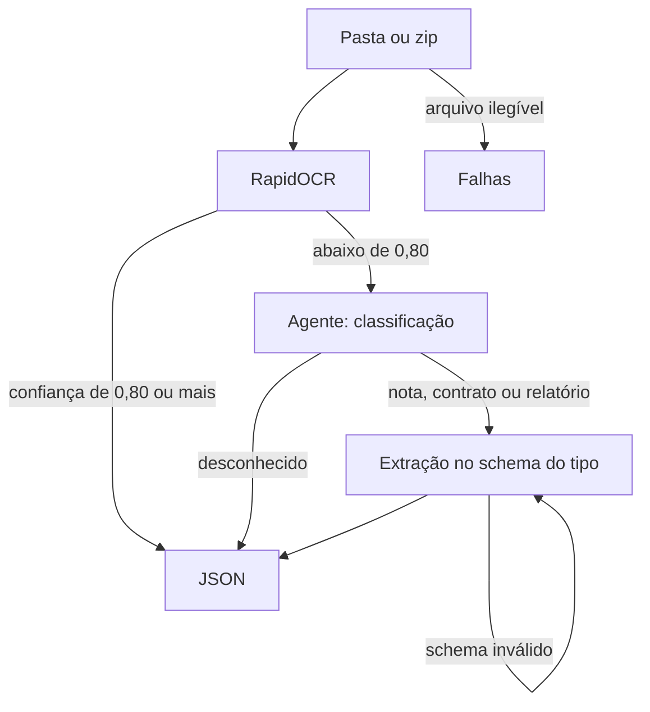

# Fila de documentos

Pipeline do desafio técnico 2. Lê uma pasta de PDFs, classifica cada arquivo, manda para o extrator do tipo e grava um JSON. Um arquivo ilegível ou uma extração inválida entra em `falhas` e o restante continua.

O anexo não tem camada de texto. Cada PDF tem cerca de 6,5 MB, mas a página útil é uma imagem PNG de uns 80 KB. O RapidOCR lê essa imagem. A confiança do documento é a menor nota entre as linhas que preencheram os campos. Em 0,80 ou mais, o JSON sai do OCR e o modelo não é chamado. Abaixo de 0,80, ou quando o formulário não fecha, a página vai para o agente. Uma linha borrada no objeto do contrato puxa o arquivo inteiro para baixo do corte, mesmo que o restante da página esteja nítido.

Uma ordem de serviço entra como relatório de manutenção: data, profissional, ativo, defeito e reparo.

## Executar

Na pasta `desafio2`:

```powershell
python -m venv .venv
.\.venv\Scripts\Activate.ps1
pip install -r requirements.txt
copy .env.example .env
```

`OPENAI_API_KEY` só é necessária quando algum arquivo fica abaixo de 0,80. O modelo, nesse caso, precisa aceitar imagem. `gpt-4o-mini` serve.

Coloque os PDFs soltos em `data/raw`, ou o próprio zip nessa pasta. Os dois podem conviver: o comando lê os PDFs da pasta e os PDFs de cada `.zip` que estiver nela. Um `.txt` dentro do zip é ignorado. Se a pasta não tiver PDF nem zip, o comando usa `../anexo_desafio_2.zip`.

```powershell
python -m src --limit 3
python -m src
```

A saída fica em `data/processed/documentos.json`. Código de saída `2` quando um arquivo cai no agente e a chave não está definida. Código `1` quando não há PDF nem zip.

## Configuração

| Variável | Padrão | Uso |
|---|---|---|
| `OPENAI_API_KEY` | vazio | Obrigatória só para o arquivo que fica abaixo do corte. O modelo precisa aceitar imagem. |
| `OPENAI_BASE_URL` | vazio | Endpoint compatível. Vazio usa a OpenAI. |
| `OPENAI_MODEL` | `gpt-4o-mini` | Modelo do cliente. Temperatura 0. |
| `OCR_MIN_CONFIDENCE` | `0.80` | Corte. Abaixo disso, ou quando o formulário não fecha, o arquivo vai para o agente. |

| Argumento | Padrão | Uso |
|---|---|---|
| `--input` | `data/raw` | Pasta com PDFs soltos e zips. |
| `--zip` | `../anexo_desafio_2.zip` | Reserva, usada só quando a pasta não tem PDF nem zip. |
| `--output` | `data/processed/documentos.json` | JSON consolidado. |
| `--limit` | `0` | Quantidade máxima. Zero lê todos. |

```powershell
pip install -r requirements-dev.txt
pytest
```

Os testes não chamam o modelo. O teste do anexo só abre o primeiro PDF do zip.

## Arquitetura



O OCR reconhece os moldes impressos do anexo. Nota fiscal aparece como fatura, documento fiscal ou NF-e. Relatório aparece como ficha de serviço, ordem de serviço ou relatório técnico. Contrato aparece como instrumento, acordo lado a lado, cláusulas ou contrato de serviço. A nota de cada linha vem do RapidOCR. A confiança do arquivo é a menor delas entre as linhas usadas nos campos. Um CNPJ fora da máscara `00.000.000/0000-00` e sem 14 dígitos corridos deixa o arquivo com o agente, mesmo com a linha nítida. O agente só entra abaixo de 0,80.

O grafo do agente, em LangGraph, tem dois nós: `classify` e `extract`. Cada extrator devolve um modelo Pydantic fechado. Se a primeira leitura não valida, o erro volta uma vez para o modelo. A segunda falha fica registrada naquele arquivo. O texto do OCR vai junto no prompt, e a imagem também.

O lote é sequencial. Quem passou no OCR não gasta chamada. Quem caiu no agente usa temperatura 0. Para milhões de arquivos, o próximo passo é uma fila com a chave de idempotência no `sha256` do PDF e trabalhadores em paralelo.

## Por que essa abordagem

O edital pede confiabilidade e custo para um volume que pode chegar a milhões de páginas. Três desenhos cabem nesse pedido.

Mandar cada página para um modelo de visão classifica e extrai bem, inclusive quando o scan está torto. No anexo isso seriam 50 chamadas, e em milhões de documentos o custo e a latência passam a ser o caminho comum, não a exceção.

Ficar só no OCR é barato e repetível. A página impressa deste anexo é nítida na maior parte dos arquivos. O risco é outro: uma linha do objeto sai borrada com nota 0,60, ou o CNPJ perde a máscara, e o JSON sai completo e errado.

O corte em 0,80 junta os dois. O RapidOCR preenche o schema quando a menor nota das linhas usadas fecha os campos. Abaixo disso, o LangGraph classifica e extrai uma vez, com o texto do OCR e a imagem, e tenta de novo se o Pydantic recusar. Neste anexo, 30 arquivos ficaram no OCR e 20 foram para o agente. Os 20 voltaram com o tipo certo e os campos obrigatórios preenchidos. Um arquivo ilegível não derruba o lote: entra em `falhas` e o próximo segue.

## Saída

Cada documento traz `arquivo`, `sha256`, `tipo`, `confianca`, `dados` e `origem`. `origem` é `ocr` ou `agente`. No OCR, `confianca` é a menor nota das linhas usadas, de 0 a 1. No agente, continua `alta`, `media` ou `baixa`. `dados` segue o tipo:

- nota fiscal: fornecedor, CNPJ, data, itens (descrição, quantidade, valor) e valor total
- contrato: contratante, contratado, objeto, vigência e valor mensal
- relatório: data, técnico, equipamento, problema e solução

Datas saem em `YYYY-MM-DD`. Valores numéricos usam ponto decimal. `falhas` lista o arquivo e o erro, sem derrubar o lote.
